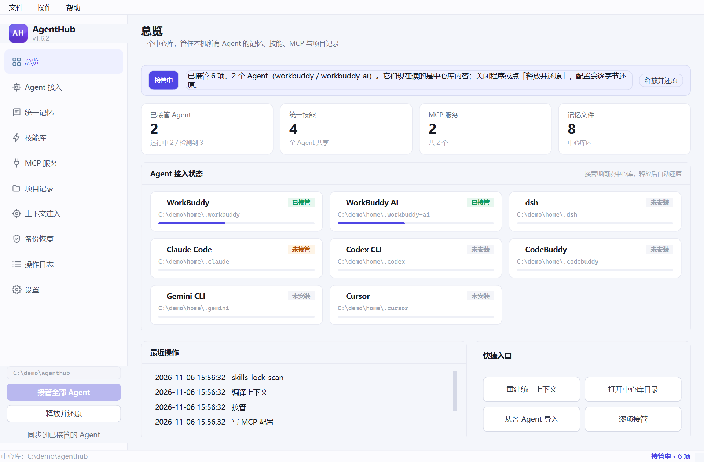

# AgentHub

Windows 桌面小工具：把本机几个 AI Agent（WorkBuddy、Claude Code、Cursor 等）的
**记忆、技能、MCP 配置**收进一个地方统一管。程序关掉时，各 Agent 的配置原样还原。

## 下载

**[→ 下载 AgentHub-1.6.2-win64.zip（28 MB）](../../releases/latest)**

1. 解压到任意目录（别放在 `C:\Program Files` 下，可能没有写权限）
2. 双击 `AgentHub.exe`
3. 不用装 Python，不联网

## 它做什么

- 启动时把正在运行的 Agent 的技能 / 记忆目录**指向**同一个中心库（目录联结），
  原配置先整体快照存好；
- 退出或点「释放并还原」时，删掉链接、把快照搬回原位，**逐字节**恢复成接管前的样子；
- 不想被接管的 Agent，在设置里取消它的「自动接管」即可，正在跑长任务的尤其适合这样。

中心库默认在 `~/.agenthub`，里面是记忆、技能库、MCP 清单、项目索引和操作日志。

## 系统要求

Windows 10 / 11，64 位。

## 关于隐私

程序只读写本机文件：它把各 Agent 的配置目录指到本地中心库，**不联网、不开端口、不上传任何内容**。

## 许可

MIT，见 [LICENSE](LICENSE)。
